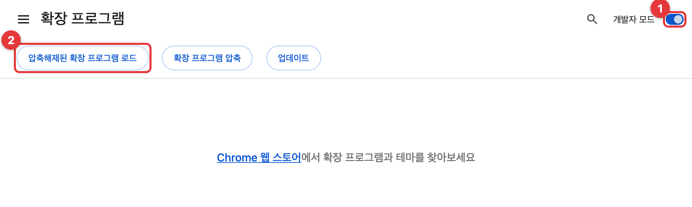
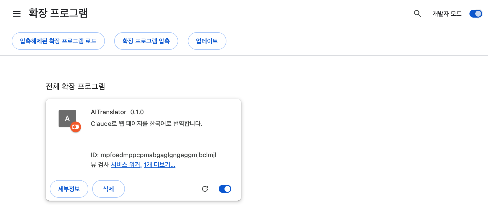
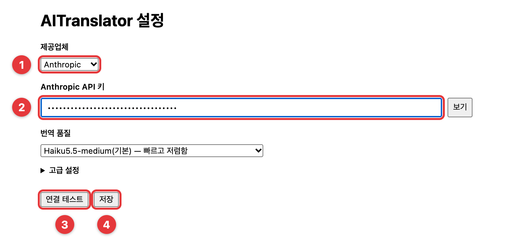
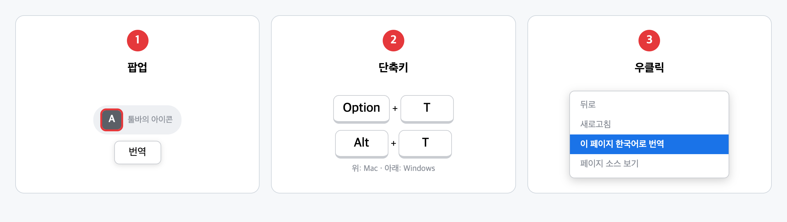
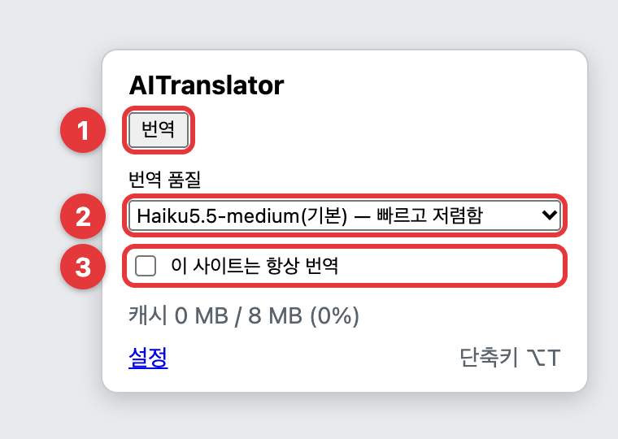
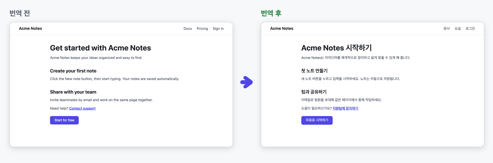
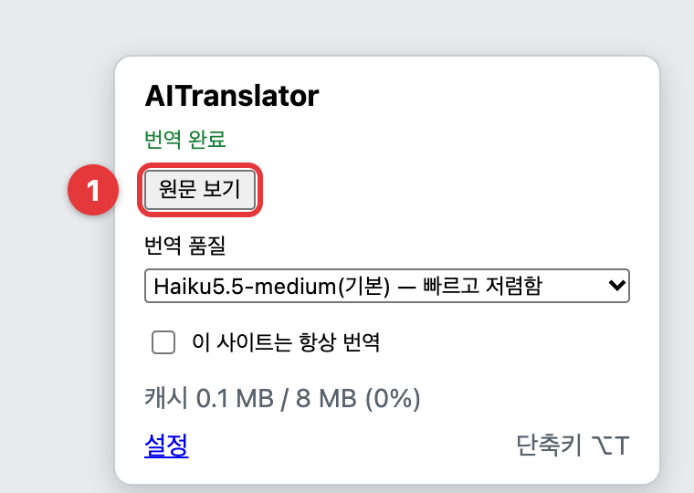

# AITranslator 빠른 사용 가이드

웹 페이지를 Claude로 한국어 번역하는 Chrome 확장 프로그램입니다.
준비물: Chrome 130 이상, API 키 하나 ([Anthropic](https://console.anthropic.com/) 또는 [OpenRouter](https://openrouter.ai/settings/keys), 쓴 만큼 요금이 나갑니다)

## 1. 설치

받은 `dist` 폴더를 지우지 않을 곳에 둡니다. zip이면 먼저 압축을 풉니다. 설치한 뒤에 폴더를 지우거나 옮기면 동작하지 않습니다.

주소창에 `chrome://extensions`를 입력하고 **① 개발자 모드**를 켠 뒤 **② 압축해제된 확장 프로그램 로드**를 눌러 `dist` 폴더를 고릅니다.

목록에 AITranslator가 보이면 설치가 끝난 것입니다.

## 2. API 키 넣기

설치하면 설정 페이지가 저절로 열립니다. 닫았다면 툴바의 AITranslator 아이콘을 누르고 아래의 **설정**을 누릅니다.

**① 제공업체**를 고르고 **② API 키**를 붙여 넣은 뒤 **③ 연결 테스트**로 확인하고 **④ 저장**을 누릅니다.

## 3. 번역하기

세 가지 중 편한 방법을 씁니다.

팝업에서는 **① 번역**을 누릅니다. **② 번역 품질**을 바꾸거나 **③ 이 사이트는 항상 번역**을 켜 둘 수도 있습니다. ③을 켜면 그 사이트를 열 때마다 자동으로 번역합니다.

## 4. 결과

번역이 끝나면 글자만 한국어로 바뀌고 페이지 모양은 그대로입니다.

**① 원문 보기**를 누르면 원문으로 돌아가고, 단축키로도 번역과 원문을 오갈 수 있습니다.

## 알아 두기

- 번역할 때 페이지의 글이 고른 제공업체(Anthropic 또는 OpenRouter)로 전송됩니다.
- 한 번 번역한 문장은 저장해 두므로 같은 문장은 다시 번역해도 요금이 들지 않습니다.
- 번역 품질은 기본(Haiku)이 가장 저렴하고, Sonnet은 약 20배, Opus는 약 40배 비쌉니다.
- 새 버전을 받으면 같은 자리의 `dist` 폴더를 덮어쓰고 `chrome://extensions`에서 AITranslator의 새로고침 버튼을 누릅니다. 설정은 그대로 남습니다.
- 단축키가 안 되면 `chrome://extensions/shortcuts`에서 다시 정합니다.

> 그림의 화면은 한국어 Chromium에서 캡처했습니다. 실제 Chrome에서는 "압축해제된 확장 프로그램을 로드합니다"처럼 문구가 조금 다를 수 있습니다. 샘플 페이지(Acme Notes)와 번역문은 예시입니다.
